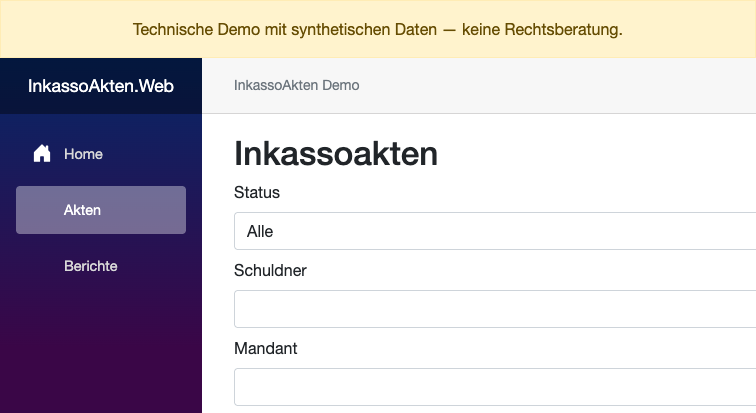
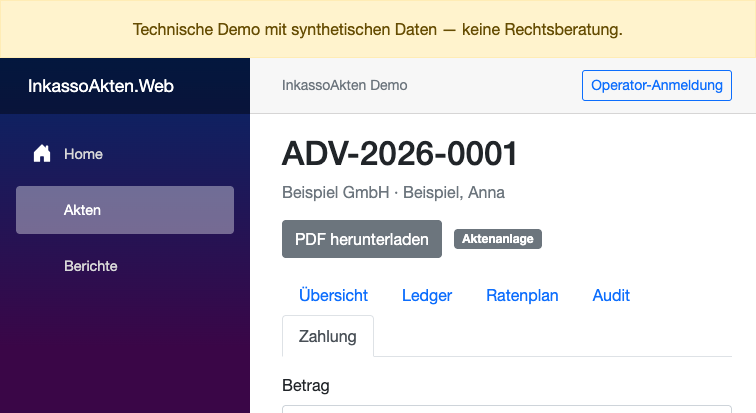
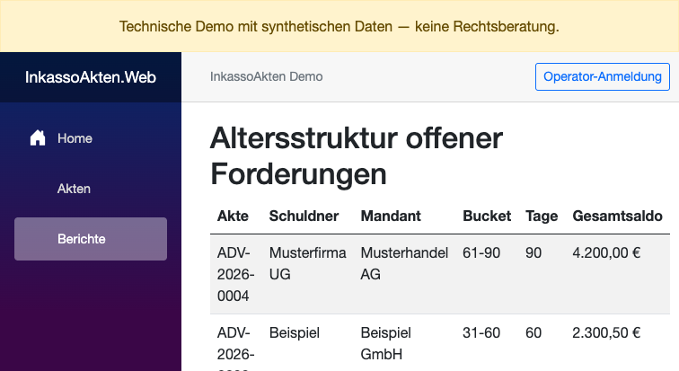

# InkassoAkten

Deterministic receivables and case management for German debt collection (technical demo).

## What it demonstrates

- .NET 8 / ASP.NET Core Blazor Server
- EF Core + SQL Server 2022
- Clean Architecture
- § 367 BGB-style allocation (costs, then interest, then principal)
- § 288 BGB interest assumptions with seeded basis rates
- State machine, immutable ledger, audit trail
- Optimistic concurrency and concurrent payment handling
- Aging report and PDF statement generation

## Tech Stack

- .NET 8 / ASP.NET Core Blazor Server
- EF Core + Microsoft.EntityFrameworkCore.SqlServer
- MS SQL Server 2022 (Docker Compose)
- xUnit + FluentAssertions + Testcontainers.MsSql
- QuestPDF (Community license) for PDF rendering in Infrastructure

## Architecture

See [docs/architecture.md](docs/architecture.md).

## Local Development

```bash
dotnet restore InkassoAkten.sln
dotnet build InkassoAkten.sln
```

## Docker

```bash
cp .env.example .env
docker compose up -d
```

## Database Migrations

```bash
dotnet ef database update --project src/InkassoAkten.Infrastructure --startup-project src/InkassoAkten.Web
```

The migration command uses the default connection string `Server=localhost,1433;Database=InkassoDb;User Id=sa;Password=YourStrong!Passw0rd;TrustServerCertificate=True;`. If `.env` changes `MSSQL_SA_PASSWORD`, `MSSQL_DB_NAME`, or `MSSQL_PORT`, set `ConnectionStrings__DefaultConnection` to the matching SQL Server connection string before running migrations or the app.

## Seed Demo Data

The web app does not seed automatically. After migrations, seed the synthetic demo data with:

```bash
dotnet run --project src/InkassoAkten.Web -- --seed-demo
```

This command applies pending migrations, inserts the five synthetic cases when the case table is empty, and makes no changes when the expected demo dataset is already present. It refuses databases that contain other case data. Use it only for an empty or disposable demo database.

## Run the Web App

```bash
dotnet run --project src/InkassoAkten.Web
```

Open `http://localhost:5018`. The default profile uses that URL. To use another SQL Server, set `ConnectionStrings__DefaultConnection` before starting the app.

## Screenshots







## Tests

```bash
dotnet test tests/InkassoAkten.Domain.Tests/InkassoAkten.Domain.Tests.csproj
dotnet test tests/InkassoAkten.IntegrationTests/InkassoAkten.IntegrationTests.csproj
```

Integration tests require a SQL Server instance. The fixture uses Testcontainers when `TEST_SQLSERVER_CONNECTIONSTRING` is not set. A pre-existing SQL Server can be used through that environment variable; use an isolated disposable test database only.

## Documentation

- [docs/architecture.md](docs/architecture.md)
- [docs/database.md](docs/database.md)
- [docs/decisions.md](docs/decisions.md)

## Browser Verification (Phase 4C)

Verified against an isolated SQL Server database (`InkassoBrowserVerify`) with synthetic seed data only. No shared application database was mutated.

- `/akten` loads 5 synthetic cases; demo banner visible.
- Case detail, ledger, aging report (`/berichte`), and PDF download (`/api/akten/{id}/pdf`) work anonymously.
- Payment preview computes the § 367 BGB allocation (costs → interest → principal) without persisting.
- Anonymous payment posting and state changes are rejected; UI shows "Zahlung verbuchen erfordert Operator-Anmeldung."
- Operator login form carries and validates an antiforgery token.
- Valid operator login enables posting; a 50,00 € payment updated balance, ledger, and audit trail.
- Overpayment is rejected with "Payment exceeds outstanding balance."
- State transition (Aktenanlage → VorgerichtlicheMahnung) succeeded with "Aktion ausgeführt."
- Logout removes write access; after logout the payment form shows the login-required notice.
- Login rate limit: 5 requests pass, 6th returns 429.
- PDF rate limit: 30 requests pass, 31st returns 429.
- Both limits use a fixed window per endpoint (global per server instance, not per user/session).

Known limitations:
- `AuthenticationStateChanged` updates the in-circuit operator flag on login/logout, but it does not automatically revalidate cookie expiry or cross-tab logout. A stale circuit may retain the operator flag until reloaded.
- Blazor prerendering persisted antiforgery tokens under a shared key, causing a collision when both `MainLayout` and `Login` rendered; fixed by using distinct persistence keys (`logoutAntiforgeryToken` vs `antiforgeryToken`).
- DevExpress is not implemented (standard Blazor components only).
- QuestPDF Community license; commercial eligibility must be verified before commercial use.
- Full UI repeated-click protection beyond disabled submit buttons is not verified.

## Legal / Demo Limitations

This repository is a technical demonstration. It is not legal advice, not a production debt-collection system, and must not be used to make enforceable claims without qualified legal review. Synthetic seed data only.

- DevExpress was evaluated for the UI layer but is not implemented; the UI uses standard ASP.NET Core Blazor components.
- Full UI repeated-click protection has not been verified beyond disabled submit buttons.
- QuestPDF is used under its Community license; commercial-use eligibility must be verified before commercial deployment.

## License

MIT
