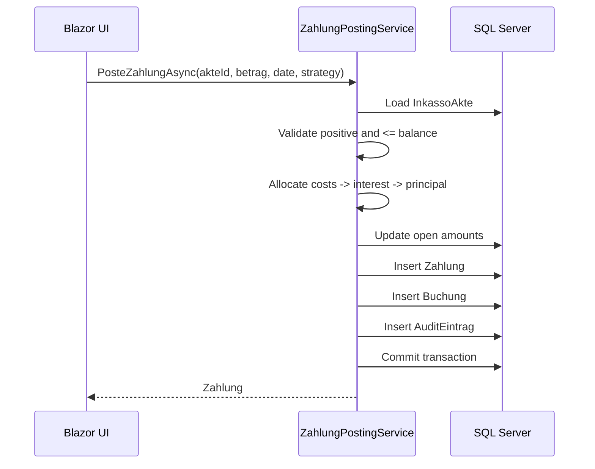
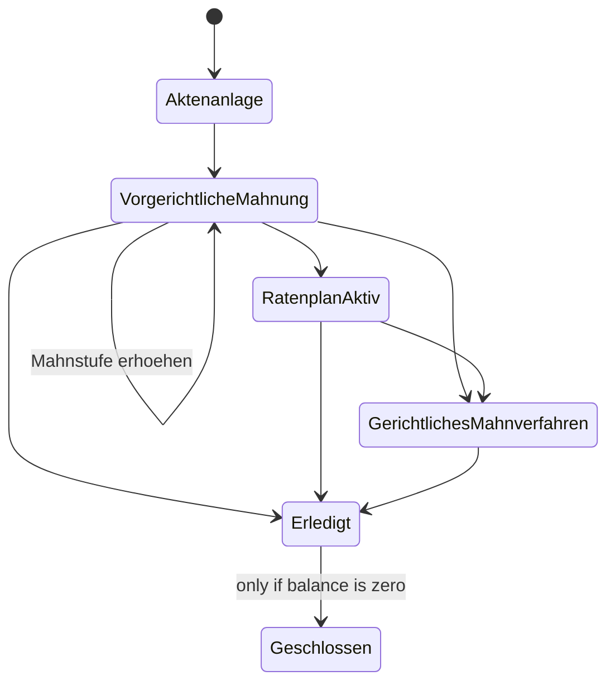

# Architecture - InkassoAkten

## Clean Architecture Boundaries

- **Domain**: Pure C# entities and business rules. No infrastructure dependencies.
- **Application**: Use cases, DTOs, persistence interfaces. No EF Core dependency.
- **Infrastructure**: EF Core DbContext, migrations, repositories, services. SQL Server provider and QuestPDF rendering live here.
- **Web**: Blazor Server UI, health endpoint, PDF download endpoint.

## Payment Sequence

## State Machine

## Concurrency

- Separate `DbContext` instances are used for concurrent payment attempts.
- Mutable aggregates use SQL Server `rowversion`.
- A successful payment updates the aggregate; a concurrent conflicting update raises `DbUpdateConcurrencyException`.
- Domain and infrastructure failures are classified separately in tests.

## QuestPDF

- Application exposes only `IPdfStatementService` and statement DTOs.
- `PdfStatementService` and the QuestPDF package are in Infrastructure.
- QuestPDF is configured with `LicenseType.Community` for open-source/evaluation use.
- Production/commercial eligibility must be confirmed against the actual QuestPDF license terms before commercial deployment.

## DevExpress

DevExpress was evaluated but not implemented. Blazor Server UI uses standard components and Bootstrap styling in Phase 3.

## Verification Status

- Full solution build: verified locally.
- Domain tests: 35/35 passed locally.
- Integration tests: not run locally because no Docker/SQL Server daemon is available in this environment. CI uses an Ubuntu runner with Docker and Testcontainers.
- Browser/UI interaction: not verified locally in this session; a successful build does not prove runtime behavior.
